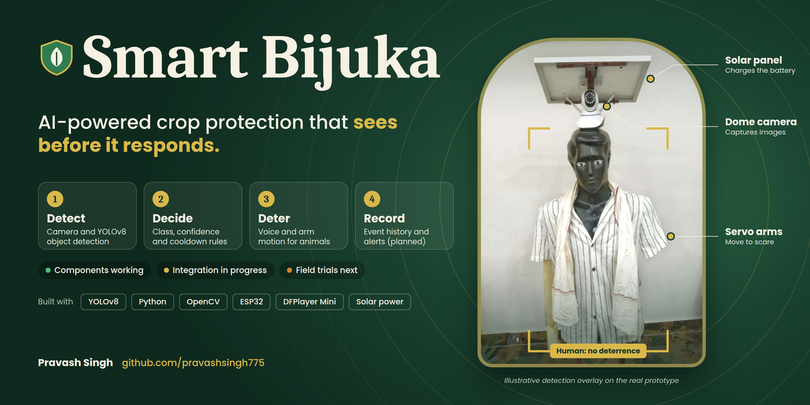
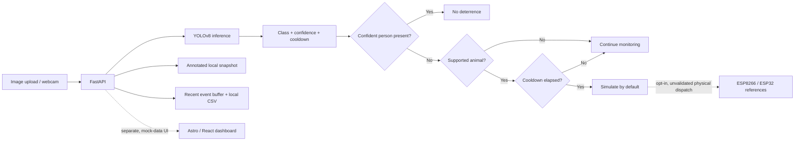

<p align="center">
  
</p>

<h1 align="center">Smart Bijuka</h1>

<p align="center">
  <strong>AI-assisted crop protection that sees before it responds.</strong><br>
  A student-built, solar-compatible scarecrow prototype for selective, non-lethal crop protection.
</p>

<p align="center">
  <a href="https://github.com/pravashsingh775/Hackcult_Hackathon_IIT_Gandhinagar/actions/workflows/ci.yml"></a>
  
  
</p>

**HackCult '26 · Green Energy & Sustainability**

**Team:** Smart Scarecrow Innovators

**Team leader:** Pravash Singh

**Project stage:** Working software baseline and physical prototype; full integration and field validation are in progress.

> **Honest prototype status:** The AI API, decision policy, local event logging, and default-safe simulation can be run and tested. Hardware components have been individually demonstrated. A complete, validated field system, cloud dashboard integration, measured solar runtime, and crop-impact results are not claimed.

## The idea

Crop-raiding animals can damage a farmer's harvest, but a generic motion alarm cannot distinguish a potential animal intrusion from a farmer walking through the field. Smart Bijuka explores a **detect → decide → deter → record** workflow: run object detection, apply a class/confidence policy, and request a configurable sound and arm movement only when the policy allows it.

**Human-presence safety rule:** any confident person detection suppresses deterrence, including a frame that also contains a supported animal. Physical hardware remains disabled by default. Software policy tests do not guarantee that the vision model will always recognize a person correctly; use supervised testing and keep physical actuation off until it is validated.

## What works today

| Capability | Status |
|---|---|
| YOLOv8 detection from an uploaded image and local webcam frame | Implemented in the FastAPI backend |
| Confidence threshold, supported-class policy, and cooldown | Implemented |
| Human-only and mixed human/animal safety precedence | Implemented and covered by policy tests |
| Annotated snapshots, recent event API, and local CSV append | Implemented locally; not a cloud or multi-user data service |
| Safe simulation and optional actuator dispatch paths | Simulation is default; physical controller integration needs validation |
| Python desktop monitor | Included as a separate application |
| Astro/React dashboard | Builds and runs, but uses mock fixture data; not connected to the API |
| Physical prototype and component demonstrations | Included in project media; full end-to-end integration is in progress |
| Solar power autonomy and field-effectiveness measurements | Not yet validated |

## See it in action

Use the running API and real, permissioned test inputs for a dynamic walkthrough:

1. Start the backend and open `http://127.0.0.1:8000/docs`.
2. Show `GET /api/status`; verify the model state and that hardware is disabled.
3. Use `POST /api/detect/image` with an animal image, then a person-only image.
4. Use a mixed person-and-animal image to demonstrate that human presence suppresses deterrence.
5. Show the annotated snapshot and `GET /api/logs`. Explain that events are local, not cloud-synced.
6. Describe which physical parts have been demonstrated, and which full-system tests remain.

Historical prototype clips (not a substitute for the required HackCult walkthrough):

- [Component working video](assets/demo/Smart%20Bijuka%20Component%20Working%20Video.mp4)
- [Prototype video](assets/demo/Smart%20Bijuka%20prortotype%20video.mp4)

**Phase 1 video:** an unlisted YouTube walkthrough still needs to be recorded and added to the event submission. Add its URL to the pitch deck's final slide once it is ready.

## Architecture



See [docs/ARCHITECTURE.md](docs/ARCHITECTURE.md) for the API, current event fields, proposed (not implemented) PostgreSQL schema, and scalability boundaries.

## Run the API locally

**Requirements:** Windows, Python 3.10+, and internet access on first launch if Ultralytics needs to obtain model weights. A webcam is needed only for live-camera endpoints.

From the repository root in PowerShell:

```powershell
py -3.10 -m venv .venv
.\.venv\Scripts\Activate.ps1
python -m pip install --upgrade pip
python -m pip install -r software\backend\requirements.txt
python -m uvicorn main:app --app-dir software\backend --host 127.0.0.1 --port 8000
```

Open [the interactive API docs](http://127.0.0.1:8000/docs). Check the local system status from another PowerShell window:

```powershell
Invoke-RestMethod http://127.0.0.1:8000/api/status | ConvertTo-Json -Depth 6
```

The backend binds to localhost for local use. It does **not** implement authentication, authorization, rate limiting, or production hardening; do not expose it directly to the internet.

### Useful endpoints

| Method | Route | What it does |
|---|---|---|
| `GET` | `/api/status` | Model, camera, actuator, audio, and policy state |
| `GET` | `/api/classes` | Loaded model labels and configured animal labels |
| `POST` | `/api/detect/image` | Analyze an uploaded image and return decisions/snapshot |
| `POST` | `/api/camera/start` | Start the host's webcam |
| `POST` | `/api/detect/frame` | Analyze the latest webcam frame |
| `GET` | `/api/camera/stream` | Stream annotated frames while the camera runs |
| `GET` | `/api/logs` | Read recent in-process events |

## Run tests

Install the backend dependencies above, then run these from the repository root:

```powershell
python tests\test_detection.py
python tests\test_acceptance.py
```

The acceptance suite tests animal decisions, human and mixed-scene suppression (in either detection order), unsupported/low-confidence objects, cooldown, default-safe actuator simulation, and local audio controls. CI also builds the web app. Synthetic policy tests are **not** model-accuracy benchmarks or field-reliability tests.

## Optional: web dashboard and desktop app

### Web UI

```powershell
cd software\Smart_Bijuka_Website
npm ci
npm run dev
```

Open `http://localhost:4321`. This UI currently uses mock fixtures; its charts, events, and device telemetry do not represent live API responses or field measurements. Build it with `npm run build`.

### Python desktop monitor

From the repository root:

```powershell
python -m pip install -r requirements.txt
python software\src\app.py --check
python software\src\app.py --image path\to\your\test-image.jpg
```

The desktop application is a separate software generation from the FastAPI backend.

## Hardware and responsible testing

- **Simulation is the default.** Do not enable a physical actuator until the controller, firmware, wiring, power rails, and emergency stop have been checked.
- This repository has ESP8266 firmware and separate ESP32 integration notes. Verify the actual board and pin mapping rather than combining the two references.
- Use a correctly rated external servo supply and a common ground as required by the actual circuit; do not power a high-current servo from a microcontroller pin.
- The project has no validated end-to-end deployment, measured overnight solar runtime, or controlled field-effectiveness study yet.
- Test only on equipment and fields you are authorized to use. Keep people and animals clear of moving hardware and loud audio during supervised tests.

See the [firmware guide](firmware/README.md), [hardware notes](hardware/README.md), and [ESP32 integration reference](docs/HARDWARE_INTEGRATION_ESP32.md).

## HackCult Phase 1 checklist

- [x] Public source repository and setup documentation
- [x] Architecture diagram, current event model, and clearly labeled proposed database design
- [x] Pitch deck with the public repository URL: [HackCult26-Smart-Bijuka-Pitch-Deck.pptx](docs/HackCult26-Smart-Bijuka-Pitch-Deck.pptx)
- [ ] Record and upload the required unlisted YouTube walkthrough; add the link to the deck and submission form
- [ ] Confirm the official deadline on the event portal: the supplied event listing conflicts between **4 November 2026, 6:30 PM IST** and **11:59 PM IST**

More detail: [docs/PHASE1_SUBMISSION.md](docs/PHASE1_SUBMISSION.md).

## Evidence, limits, and next evaluation

The deck's **87% cow result is one sample-image confidence**, not an accuracy measurement. Older project documents contain additional performance claims; verify their datasets and methodology before citing them as HackCult results.

The next meaningful evaluations are held-out per-class precision/recall, mixed-scene safety tests, end-to-end latency on target hardware, camera/network interruption recovery, physical actuator reliability, current draw, and measured battery/solar runtime. The current running baseline does not provide a production database, remote notifications, or live multi-device dashboard.

## Repository map

```text
assets/images/                  Project photos, diagrams, and HackCult poster
assets/demo/                    Selected prototype demonstration clips
docs/ARCHITECTURE.md            Current architecture and proposed data schema
docs/PHASE1_SUBMISSION.md       Walkthrough and submission checklist
docs/HackCult26-...pptx         HackCult pitch deck
firmware/                       ESP8266 prototype firmware
hardware/                       Wiring references and hardware notes
software/backend/               FastAPI detection and decision services
software/src/                   Python desktop detector
software/Smart_Bijuka_Website/  Astro/React UI (mock data)
tests/                          Detection and safety-policy tests
```

## License

MIT. See [LICENSE](LICENSE).
