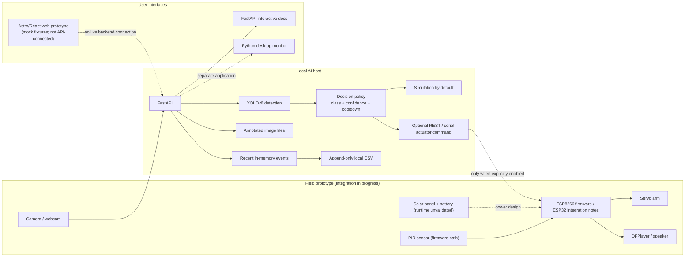

# Smart Bijuka architecture and data model

## Current system

The implementation is a local, single-host prototype. The Python backend can capture a local webcam frame or accept an uploaded image, run YOLOv8 inference, evaluate a selective-response policy, save an annotated snapshot, and append event records to a local CSV file. A response is simulated by default; physical actuation is only attempted when explicitly enabled and configured.



The dotted connections are intended/configurable paths, not evidence that the full field system is integrated. The deck identifies individual component tests and a sample image detection as demonstrated; it also identifies camera-to-controller integration, field validation, remote alerts, and power-runtime measurement as incomplete.

## Detection and response flow

1. `/api/detect/image` receives one image, or the webcam endpoints provide a current frame.
2. `DetectionService` calls YOLOv8 and returns class labels, confidence values, bounding boxes, and whether a class is a configured animal or a person.
3. `DecisionService` allows only configured animal labels above the configured confidence threshold. It applies a cooldown and does not automatically actuate for a still image.
4. A person-only detection returns `HUMAN_NO_REACTION`. The current policy checks supported animals first; a mixed person-and-animal frame can authorize deterrence. This is not a blanket human-presence interlock.
5. If authorized, the response service plays the selected audio and updates the actuator state. The default is simulation; an explicitly enabled REST/serial path may dispatch a physical command.
6. The backend saves annotated snapshots in `software/backend/static/uploads/`. Selected animal/human events are appended to `software/logs/events.csv`.

## Current API surface

| Method | Endpoint | Current behavior |
|---|---|---|
| `GET` | `/` | Backend health and model-load flag |
| `GET` | `/api/status` | AI, camera, actuator, audio, and policy state |
| `GET` | `/api/classes` | Model and configured animal classes |
| `POST` | `/api/config` | Runtime configuration update (not persisted) |
| `POST` | `/api/detect/image` | Image upload, inference, policy, snapshot, event |
| `POST` | `/api/camera/start` | Start local webcam |
| `POST` | `/api/camera/stop` | Stop local webcam |
| `POST` | `/api/detect/frame` | Inference on current webcam frame |
| `GET` | `/api/camera/stream` | Annotated MJPEG stream while camera is active |
| `GET` | `/api/audio/files` | List available local audio |
| `POST` | `/api/audio/select`, `/api/audio/test`, `/api/audio/stop` | Local audio controls |
| `POST` | `/api/actuator/test`, `/api/actuator/reset` | Test/reset simulation or configured actuator |
| `GET` | `/api/logs` | Read recent process-local events |
| `DELETE` | `/api/logs` | Clear the in-memory event list; it does not delete the CSV |

Run the API locally and use `/docs` for request fields and response examples. No authentication is implemented; keep the server bound to localhost for demonstrations.

## Current event record

The backend response model and CSV row use the following fields:

| Field | Type | Meaning |
|---|---|---|
| `id` | string | Short event identifier |
| `timestamp` | string | Local event time |
| `mode` | string | Detection source, such as image upload or laptop camera |
| `primary_class` | string | Highest-ranked detected class, or `None` |
| `confidence` | float | Confidence for the primary detection |
| `decision_status` | string | Policy outcome code |
| `action_taken` | string | Human-readable policy/action outcome |
| `audio_played` | boolean | Whether audio playback was requested successfully |
| `actuator_fired` | boolean | Whether the policy requested actuation |
| `hardware_mode` | string | Simulation or physical mode label |
| `snapshot_url` | optional string | Local annotated-image URL |

The current logger keeps at most 100 records in process memory for `/api/logs` and appends records to CSV. It does not currently reload CSV history after restart, store a relational database, synchronize with Supabase, or provide durable multi-device event history.

## Database schema requested for the pitch

There is **no database in the current running baseline**. The following normalized PostgreSQL design is a proposal for a future persistent multi-device version, not an implemented schema:

```sql
CREATE TABLE devices (
    device_id UUID PRIMARY KEY,
    display_name TEXT NOT NULL,
    hardware_type TEXT NOT NULL,
    created_at TIMESTAMPTZ NOT NULL DEFAULT now()
);

CREATE TABLE detection_events (
    event_id UUID PRIMARY KEY,
    device_id UUID REFERENCES devices(device_id),
    captured_at TIMESTAMPTZ NOT NULL,
    source TEXT NOT NULL,
    decision_status TEXT NOT NULL,
    action_taken TEXT NOT NULL,
    hardware_mode TEXT NOT NULL,
    snapshot_path TEXT
);

CREATE TABLE detections (
    detection_id BIGINT GENERATED ALWAYS AS IDENTITY PRIMARY KEY,
    event_id UUID NOT NULL REFERENCES detection_events(event_id) ON DELETE CASCADE,
    class_name TEXT NOT NULL,
    confidence REAL NOT NULL CHECK (confidence >= 0 AND confidence <= 1),
    is_supported_animal BOOLEAN NOT NULL,
    is_human BOOLEAN NOT NULL,
    x1 INTEGER NOT NULL,
    y1 INTEGER NOT NULL,
    x2 INTEGER NOT NULL,
    y2 INTEGER NOT NULL
);

CREATE INDEX detection_events_device_time_idx
    ON detection_events (device_id, captured_at DESC);
CREATE INDEX detections_event_idx ON detections (event_id);
```

This separates device identity, event decisions, and per-object detections while allowing chronological device queries. Before production use, define retention and access control for images, validate migrations, and add authentication and authorization.

## Scalability and reliability boundaries

- **Current:** one local process, one camera source at a time, CPU inference, in-memory runtime settings and recent-event list, local snapshots and CSV.
- **Not implemented:** durable database, multi-user access, multi-device coordination, cloud synchronization, notification delivery, authenticated APIs, production deployment, or load-tested concurrency.
- **Next scaling step:** persist events in PostgreSQL, store snapshots in object storage, register devices, authenticate clients, and queue event/notification work. Add retries and idempotency before connecting unreliable rural links.
- **Evaluation needed:** measure end-to-end latency, false positives/negatives per class and lighting condition, cooldown behavior, camera disconnect recovery, actuator response, energy consumption, and battery runtime under controlled repeatable tests.
