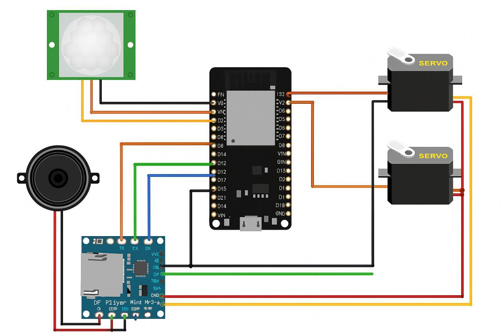

# 🔌 Hardware & Circuit Design — Smart Bijuka

This folder contains the complete circuit schematics, hardware Bill of Materials (BOM), and physical wiring references for the **Smart Bijuka** physical field unit.

---

## 🛠️ Bill of Materials (BOM)

| Component | Quantity | Specification / Model | Functional Role |
|-----------|----------|-----------------------|-----------------|
| **Microcontroller** | 1 | ESP8266 NodeMCU v2/v3 (ESP-12E) | Core processor, Wi-Fi telemetry & actuator orchestration |
| **Motion Sensor** | 1 | HC-SR501 PIR Sensor | 120° wide-angle passive infrared intrusion detection |
| **Actuator Servo** | 1 | MG996R High-Torque Metal Gear Servo | 180° bidirectional scarecrow arm / visual deterrent movement |
| **Audio Engine** | 1 | DFPlayer Mini MP3 Player | Onboard SD-card based bioacoustic distress frequency playback |
| **Audio Output** | 1 | 8Ω 3W Full-range Speaker | Acoustic deterrent sound emitter |
| **Power Converter** | 1 | LM2596 DC-DC Buck Converter Step-Down | Steps down 12V solar battery bus to regulated 5V (3A max) |
| **Resistors** | 1 | 1 kΩ (0.25W) | Serial RX noise dampening & level shift for DFPlayer |
| **Power Supply** | 1 | 12V 7Ah Battery + 20W Solar Panel | Off-grid renewable power subsystem |

---

## 📐 Schematics & Wiring Diagrams

| Diagram | Preview |
|---------|---------|
| **Full System Circuit Diagram** |  |
| **Physical Wiring Layout** |  |

---

## ⚡ Electrical & Power Distribution Guidelines

1. **Common Ground:** Always tie the ESP8266 `GND`, LM2596 `OUT-`, Servo `GND`, and DFPlayer `GND` together to prevent ground loops and erratic servo jitter.
2. **Current Spikes:** The MG996R high-torque servo can draw up to **1.5A peak** during rapid acceleration. Power it directly from the LM2596 5V output rail rather than the ESP8266 onboard 3.3V/5V pin to avoid MCU brownouts.
3. **Serial Communication:** Insert a **1 kΩ resistor** in series between ESP8266 `D1 (TX)` and DFPlayer Mini `RX` to protect against 5V/3.3V logic discrepancies and eliminate audio hum.
4. **PIR Sensor Tuning:** Set the HC-SR501 time-delay potentiometer to the minimum (~3 seconds) and sensitivity to ~5-7 meters for optimal field response.
